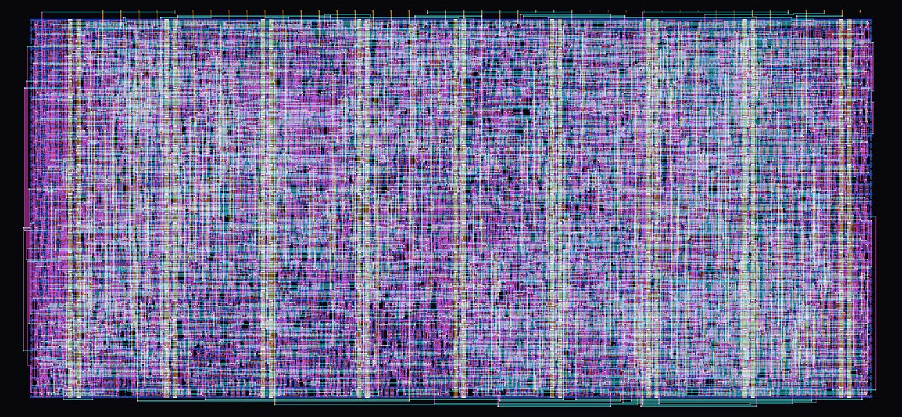

   

# GPS disciplined oscillator on GF180

This is a GPSDO controller that fits in one Tiny Tapeout tile on
GlobalFoundries 180 nm. It:

- times each GPS pulse to a fraction of a clock cycle with an on-chip delay
  line
- calibrates that line against the clock every second
- steers a 10 MHz oscillator through a sigma-delta DAC

It also has holdover, a triplicated loop integrator, a ring oscillator
process monitor and UART telemetry.

It fills 95% of the 1x1 tile, with no setup or hold violations at any
corner, and LVS, DRC and antenna clean, see the
[gds workflow](../../actions/workflows/gds.yaml) for the reports.

The hardened tile, 347 x 161 µm. There is also a
[3D viewer](https://kfilipekk.github.io/tt-gpsdo).

It is the ASIC version of [fpga_gps_clock](https://github.com/kfilipekk/fpga_gps_clock),
a GPSDO with a carry chain TDC on a Tang Nano 9K. That board held an OCXO to
0.05 ppb at 4096 s against GPS, measured in loop. Here the FPGA carry chain
becomes a chain of `dlyd` cells, calibrated against the clock every second so
process, voltage and temperature drop out. On a die fast enough that the line
is shorter than a cycle it calibrates on half cycles instead.

- [Datasheet: how it works, how to test, hardware](docs/info.md)
- [Testbench](test/README.md)

## Source

| Block | What |
| --- | --- |
| `src/tdc.v` | 44 tap delay line, sampled every clock, bubbles counted not decoded |
| `src/loop.v` | integral loop: saturating, TMR integrator, gain select |
| `src/tmr_reg.v` | kept flip-flops for the voted integrator |
| `src/ring.v` | 31 stage ring oscillator and ripple divider |
| `src/uart_tx.v` | telemetry at 115200 baud |
| `src/project.v` | phase counter, self calibration, sigma-delta, telemetry |
| `src/gpsdo.sdc` | false paths through the delay line and the ring |

## Verification

- `test/`: cocotb RTL tests, a gate level run, and a timing run with the
  delay line annotated from the layout SDF at tt, ff and ss
- `formal/`: SymbiYosys proofs by induction of the TDC handshake, the
  voted, saturating integrator and the top level phase counter at the real
  10 MHz second, run in CI
