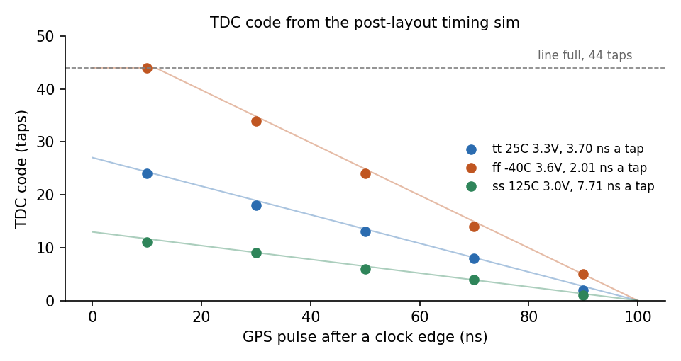
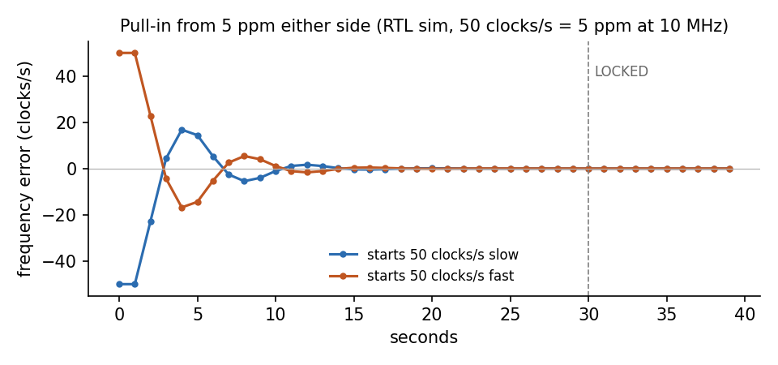

   

# GPS disciplined oscillator on GF180

This is a complete GPSDO controller that fits in a single Tiny Tapeout 1x1
tile on GlobalFoundries 180 nm. It:

- times each GPS pulse to a fraction of a clock cycle with an on-chip delay line (~3.4 ns resolution)
- calibrates that line against the clock every second against PVT variations
- steers a 10 MHz oscillator (OCXO or VCTCXO) through a 16-bit sigma-delta DAC
- supports both positive and negative oscillator tuning slopes (`INV_SLOPE`)

It also features automatic holdover, a radiation-hardened triplicated (TMR) loop integrator,
an on-die ring oscillator process monitor, and real-time ASCII telemetry over UART.

It fills 95% of the 1x1 tile, with no setup or hold violations at any
corner, and LVS, DRC and antenna clean, see the
[gds workflow](../../actions/workflows/gds.yaml) for the reports.

The hardened tile, 347 x 161 µm. There is also a
[3D viewer](https://kfilipekk.github.io/tt-gpsdo).

## Why a GPSDO?

High-precision timing faces a fundamental physics trade-off:

* **Crystal oscillators (OCXO / TCXO)** have **superb short-term stability and ultra-low phase noise** over milliseconds to seconds, but they suffer from **thermal drift and physical aging** over hours, days, and months.
* **GPS satellite signals** are steered by onboard cesium/rubidium atomic clocks and have **zero long-term drift**, but individual pulses suffer from **short-term jitter** (10–30 ns from atmospheric variations and receiver clock quantization).

A **GPS Disciplined Oscillator (GPSDO)** locks the two together to get the best of both worlds:
1. **Short term ($\tau < 10\text{ s}$)**: The clean, jitter-free phase noise of the local crystal oscillator.
2. **Long term ($\tau > 100\text{ s}$)**: The drift-free atomic precision of GPS, achieving parts-per-billion (ppb) to parts-per-trillion (ppt) frequency accuracy over hours and years.

### Practical Applications
* **Bench Reference Clock**: Master 10 MHz frequency standard for lab equipment (frequency counters, spectrum analyzers, oscilloscopes, signal generators) without needing an expensive rubidium or cesium beam standard.
* **Software-Defined Radio (SDR) & RF**: Stable local oscillator for microwave transverters (10 GHz+), satellite ground stations, and narrowband digital amateur radio modes (FT8, WSPR) where even a 1 Hz drift drops decode packets.
* **Network Timekeeping**: Accurate timebase for Stratum-1 NTP and IEEE 1588 PTP servers in telecommunications and data centers.

It is the ASIC version of [fpga_gps_clock](https://github.com/kfilipekk/fpga_gps_clock),
a GPSDO with a carry chain TDC on a Tang Nano 9K. That board held an OCXO to
0.05 ppb at 4096 s against GPS, measured in loop. Here the FPGA carry chain
becomes a chain of `dlyd` cells, calibrated against the clock every second so
process, voltage and temperature drop out. On a die fast enough that the line
is shorter than a cycle it calibrates on half cycles instead.

- [Datasheet: how it works, how to test, hardware](docs/info.md)
- [Testbench](test/README.md)

## Simulation

The TDC on the hardened netlist with layout delays: the code falls one tap per
tap delay as the pulse lands later in the cycle, at 3.7 ns a tap typical, 2.0
fast and 7.7 slow. On the fast corner the 44 taps are shorter than a cycle, so
the first ~12 ns after an edge read as a full line.

Pull-in from 50 clocks a second either side, 5 ppm at 10 MHz, in the RTL
sim with a model oscillator. Both cross the counter wrap the phase arithmetic
has to handle, and `LOCKED` comes on after 15 good seconds. How fast it
settles depends on the real oscillator's tuning slope and `GAIN`.

## Source

| Block | What |
| --- | --- |
| `src/tdc.v` | 44 tap delay line, sampled every clock, bubbles counted not decoded |
| `src/loop.v` | integral loop: saturating, TMR integrator, gain select |
| `src/tmr_reg.v` | kept flip-flops for the voted integrator |
| `src/ring.v` | 31 stage ring oscillator and ripple divider |
| `src/uart_tx.v` | telemetry at 115200 baud |
| `src/project.v` | phase counter, self calibration, sigma-delta, telemetry |
| `src/gpsdo.sdc` | false paths through the delay line and the ring |

## Verification

- `test/`: cocotb RTL tests, a gate level run, and a timing run with the
  delay line annotated from the layout SDF at tt, ff and ss
- `formal/`: SymbiYosys proofs by induction of the TDC handshake, the
  voted, saturating integrator and the top level phase counter at the real
  10 MHz second, run in CI
